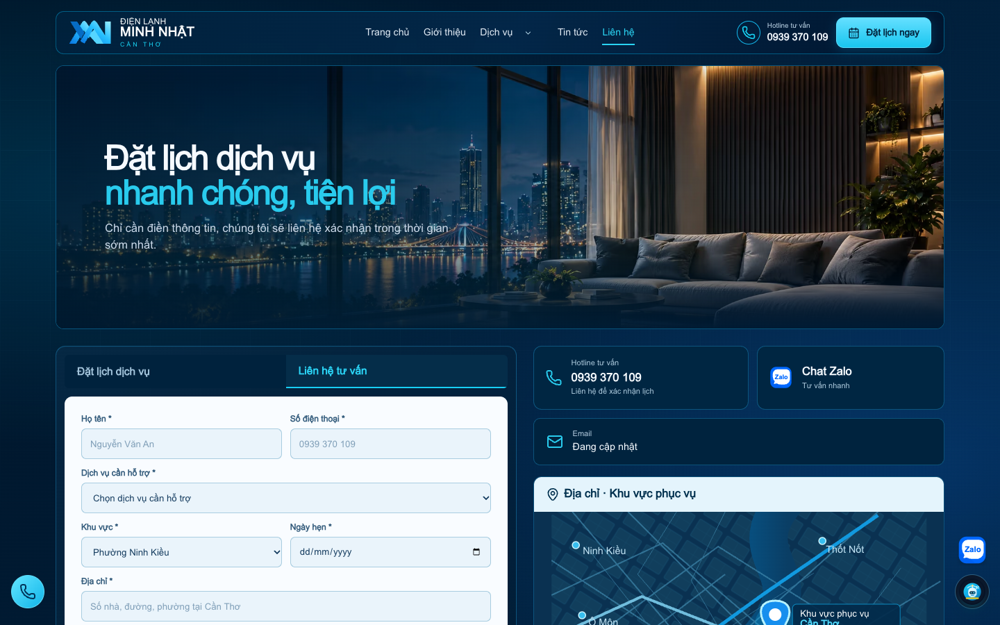
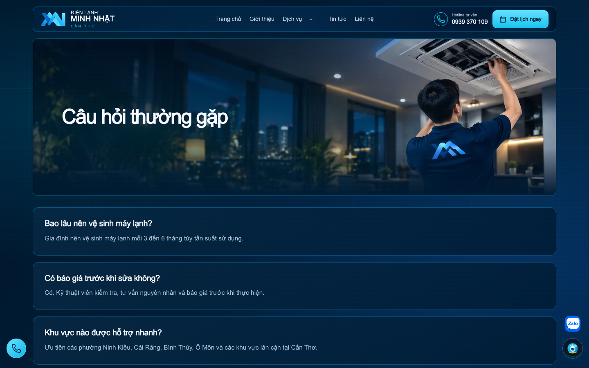
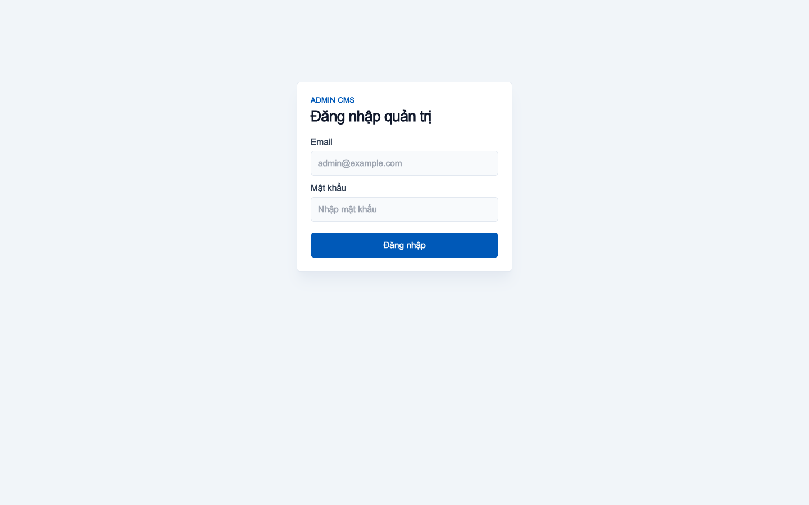
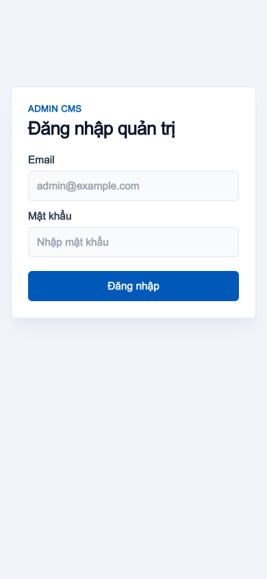

# UI audit — after-routes

Target: http://127.0.0.1:3010 · Mode: local

| Metric | Count |
| --- | ---: |
| pages | 10 |
| axeViolations | 0 |
| axeAffectedNodes | 0 |
| axeIncomplete | 8 |
| interactiveElements | 216 |
| missingTransitions | 0 |
| unsafeTransitions | 0 |
| smallTouchTargets | 0 |
| horizontalOverflows | 0 |
| layoutAnimations | 0 |

## /booking / desktop

## /booking / mobile

## /services / desktop

## /services / mobile

## /contact / desktop

## /contact / mobile

## /faq / desktop

## /faq / mobile

## /admin/login / desktop

## /admin/login / mobile

## Visual analysis

{
  "mode": "local",
  "note": "No Gemini call; inspect saved screenshots alongside DOM/Axe evidence."
}

## Limitations

- Automated checks do not establish complete WCAG compliance or actual frame rate.
- Totals count node occurrences per viewport/route; they are not unique components.
- Hidden/inert/disabled targets are excluded; unopened overlays need interaction verification.
- React debug source may be unavailable; inferred candidates require review.
- Axe incomplete checks require manual review.
