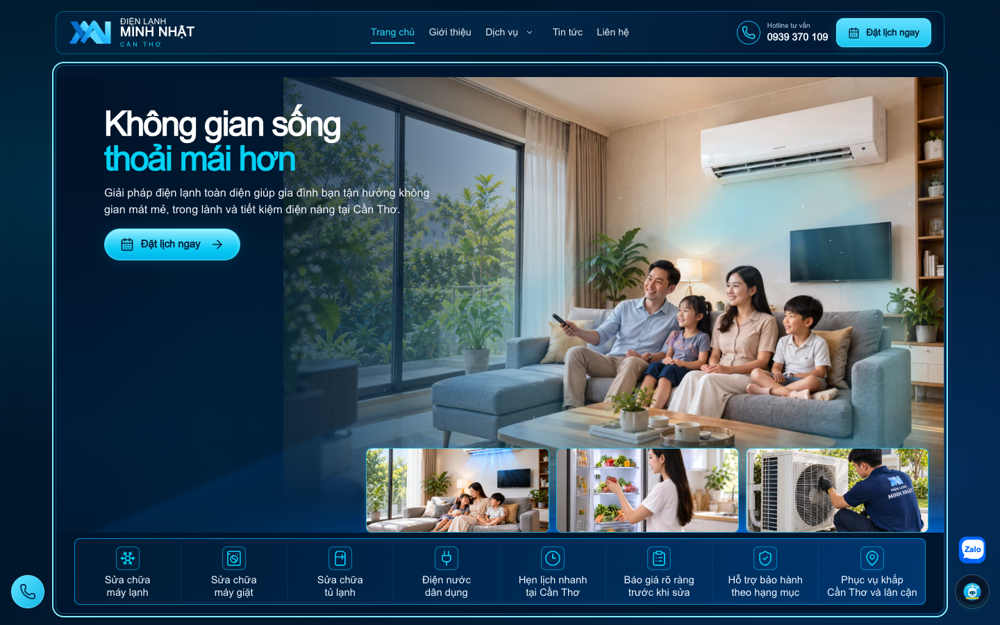

# UI audit — before

Target: http://127.0.0.1:3010 · Mode: local

| Metric | Count |
| --- | ---: |
| pages | 2 |
| axeViolations | 0 |
| axeAffectedNodes | 0 |
| axeIncomplete | 2 |
| interactiveElements | 102 |
| missingTransitions | 54 |
| unsafeTransitions | 0 |
| smallTouchTargets | 46 |
| horizontalOverflows | 0 |
| layoutAnimations | 0 |

## / / desktop

- body div:nth-of-type(2) > header > div > a — ĐIỆN LẠNH MINH NHẬT CẦN THƠ; 181.38×42.86px; small target; missing transition; source: apps/web/components/layout/site-footer.tsx:12 (inferred), apps/web/components/layout/site-header.tsx:109 (inferred), apps/web/app/redesign.css:196 (inferred), apps/web/components/layout/site-header.module.css:26 (inferred)
- body div:nth-of-type(2) > header > div > nav > a:nth-of-type(1) — Trang chủ; 63.06×39.11px; small target; missing transition; source: apps/web/components/layout/site-header.tsx:16 (inferred), apps/web/app/areas/[locationSlug]/[serviceSlug]/page.tsx:69 (inferred), apps/web/app/areas/[locationSlug]/page.tsx:56 (inferred), apps/web/app/blog/[slug]/page.tsx:177 (inferred)
- body div:nth-of-type(2) > header > div > nav > a:nth-of-type(2) — Giới thiệu; 61.06×39.11px; small target; missing transition; source: apps/web/components/layout/site-footer.tsx:59 (inferred), apps/web/app/about/page.tsx:8 (inferred), apps/web/components/layout/site-header.tsx:17 (inferred), apps/web/app/page.tsx:1 (inferred)
- body div:nth-of-type(2) > header > div > nav > div > a — Dịch vụ; 47.09×39.11px; small target; missing transition; source: apps/web/app/page.tsx:24 (inferred), apps/web/app/services/[slug]/page.tsx:85 (inferred), apps/web/components/layout/site-footer.tsx:58 (inferred), apps/web/app/about/page.tsx:9 (inferred)
- body header > div > nav > div > details > summary — Mở danh sách dịch vụ; 26×36px; small target; missing transition; source: apps/web/components/layout/site-header.tsx:133 (inferred)
- body div:nth-of-type(2) > header > div > nav > a:nth-of-type(3) — Tin tức; 43.45×39.11px; small target; missing transition; source: apps/web/app/blog/page.tsx:6 (inferred), apps/web/app/page.tsx:58 (inferred), apps/web/app/projects/page.tsx:7 (inferred), apps/web/components/layout/site-header.tsx:19 (inferred)
- body div:nth-of-type(2) > header > div > nav > a:nth-of-type(4) — Liên hệ; 46.33×39.11px; small target; missing transition; source: apps/web/components/redesign/contact-page.tsx:20 (inferred), apps/web/app/areas/[locationSlug]/page.tsx:31 (inferred), apps/web/app/contact/page.tsx:4 (inferred), apps/web/components/conversion/floating-actions.tsx:285 (inferred)
- body div:nth-of-type(2) > header > div > div > a:nth-of-type(1) — Hotline tư vấn 0939 370 109; 131.73×34px; small target; missing transition; source: apps/web/app/redesign.css:261 (inferred), apps/web/components/layout/site-header.module.css:33 (inferred), apps/web/components/layout/site-header.tsx:153 (inferred)
- body div:nth-of-type(2) > header > div > div > a:nth-of-type(2) — Đặt lịch ngay; 136.55×42px; small target; source: apps/web/components/layout/site-header.tsx:164 (inferred), apps/web/components/redesign/hero.tsx:132 (inferred), apps/web/components/redesign/ui.tsx:252 (inferred), apps/web/app/redesign.css:105 (inferred)
- body div:nth-of-type(1) > main > div > section:nth-of-type(1) > div:nth-of-type(1) > a — Xem tất cả; 93.55×21.44px; small target; missing transition; source: apps/web/components/redesign/ui.tsx:104 (inferred), apps/web/components/redesign/service-catalog.tsx:47 (inferred), apps/web/app/page.tsx:52 (inferred), apps/web/app/services/[slug]/page.tsx:41 (inferred)
- body div:nth-of-type(1) > main > div > section:nth-of-type(2) > div:nth-of-type(2) > a — Tìm hiểu về Minh Nhật →; 162.59×21.44px; small target; missing transition; source: apps/web/app/page.tsx:53 (inferred), apps/web/app/areas/[locationSlug]/[serviceSlug]/page.tsx:44 (inferred), apps/web/app/projects/[slug]/page.tsx:27 (inferred), apps/web/app/redesign.css:93 (inferred)
- body div:nth-of-type(1) > main > div > section:nth-of-type(3) > div:nth-of-type(1) > a — Xem tất cả; 93.55×21.44px; small target; missing transition; source: apps/web/components/redesign/ui.tsx:104 (inferred), apps/web/components/redesign/service-catalog.tsx:47 (inferred), apps/web/app/page.tsx:52 (inferred), apps/web/app/projects/[slug]/page.tsx:27 (inferred)
- body main > div > section:nth-of-type(4) > div:nth-of-type(2) > div > a:nth-of-type(1) — Ninh Kiều; 156.77×44px; missing transition; source: apps/web/components/redesign/service-area.tsx:183 (inferred), apps/web/lib/content/site-content.ts:37 (inferred)
- body main > div > section:nth-of-type(4) > div:nth-of-type(2) > div > a:nth-of-type(2) — Bình Thủy; 156.77×44px; missing transition; source: apps/web/components/redesign/service-area.tsx:57 (inferred), apps/web/lib/content/site-content.ts:38 (inferred)
- body main > div > section:nth-of-type(4) > div:nth-of-type(2) > div > a:nth-of-type(3) — Cái Răng; 156.77×44px; missing transition; source: apps/web/components/redesign/service-area.tsx:59 (inferred), apps/web/lib/content/site-content.ts:39 (inferred)
- body main > div > section:nth-of-type(4) > div:nth-of-type(2) > div > a:nth-of-type(4) — Ô Môn; 156.77×44px; missing transition; source: apps/web/components/redesign/service-area.tsx:58 (inferred), apps/web/lib/content/site-content.ts:40 (inferred)
- body main > div > section:nth-of-type(4) > div:nth-of-type(2) > div > a:nth-of-type(5) — Thốt Nốt; 156.77×44px; missing transition; source: apps/web/components/redesign/service-area.tsx:54 (inferred), apps/web/lib/content/site-content.ts:41 (inferred), apps/web/components/redesign/contact-page.tsx:1 (inferred)
- body main > div > section:nth-of-type(4) > div:nth-of-type(2) > div > a:nth-of-type(6) — Phong Điền; 156.77×44px; missing transition; source: apps/web/components/redesign/service-area.tsx:70 (inferred), apps/web/lib/content/site-content.ts:42 (inferred), apps/web/components/redesign/contact-page.tsx:1 (inferred)
- body main > div > section:nth-of-type(4) > div:nth-of-type(2) > div > a:nth-of-type(7) — Vĩnh Thạnh; 156.77×44px; missing transition; source: apps/web/components/redesign/service-area.tsx:55 (inferred), apps/web/lib/content/site-content.ts:43 (inferred), apps/web/components/redesign/contact-page.tsx:1 (inferred)
- body main > div > section:nth-of-type(4) > div:nth-of-type(2) > div > a:nth-of-type(8) — Cờ Đỏ; 156.77×44px; missing transition; source: apps/web/components/redesign/service-area.tsx:56 (inferred), apps/web/lib/content/site-content.ts:44 (inferred), apps/web/components/redesign/contact-page.tsx:1 (inferred)
- body main > div > section:nth-of-type(4) > div:nth-of-type(2) > div > a:nth-of-type(9) — Và các khu vực lân cận; 239.83×44px; missing transition; source: apps/web/components/redesign/service-area.tsx:113 (inferred), apps/web/components/redesign/contact-page.tsx:1 (inferred)
- body div:nth-of-type(2) > footer > div > div:nth-of-type(1) > div:nth-of-type(1) > a — ĐIỆN LẠNH MINH NHẬT CẦN THƠ; 516.25×44px; missing transition; source: apps/web/components/layout/site-footer.tsx:12 (inferred), apps/web/components/layout/site-header.tsx:109 (inferred), apps/web/app/redesign.css:196 (inferred), apps/web/components/layout/site-header.module.css:26 (inferred)
- body div:nth-of-type(2) > footer > div > div:nth-of-type(1) > div:nth-of-type(2) > a:nth-of-type(1) — 0939 370 109; 368.75×19.8px; small target; missing transition; source: unknown
- body div:nth-of-type(2) > footer > div > div:nth-of-type(1) > div:nth-of-type(2) > a:nth-of-type(2) — Tư vấn qua Zalo ↗; 368.75×19.8px; small target; missing transition; source: apps/web/components/layout/site-footer.tsx:42 (inferred)
- body div:nth-of-type(2) > footer > div > div:nth-of-type(1) > div:nth-of-type(3) > a:nth-of-type(1) — Dịch vụ điện lạnh; 295×19.8px; small target; missing transition; source: apps/web/app/page.tsx:24 (inferred), apps/web/components/layout/site-footer.tsx:58 (inferred), apps/web/app/about/page.tsx:9 (inferred), apps/web/app/areas/[locationSlug]/page.tsx:16 (inferred)
- body div:nth-of-type(2) > footer > div > div:nth-of-type(1) > div:nth-of-type(3) > a:nth-of-type(2) — Giới thiệu Minh Nhật; 295×19.8px; small target; missing transition; source: apps/web/components/layout/site-footer.tsx:59 (inferred), apps/web/app/page.tsx:1 (inferred)
- body div:nth-of-type(2) > footer > div > div:nth-of-type(1) > div:nth-of-type(3) > a:nth-of-type(3) — Câu hỏi thường gặp; 295×19.8px; small target; missing transition; source: apps/web/components/layout/site-footer.tsx:60 (inferred), apps/web/app/faq/page.tsx:9 (inferred), apps/web/app/services/[slug]/page.tsx:59 (inferred)
- body div:nth-of-type(2) > footer > div > div:nth-of-type(1) > div:nth-of-type(3) > a:nth-of-type(4) — Đặt lịch dịch vụ; 295×19.8px; small target; missing transition; source: apps/web/components/layout/site-footer.tsx:61 (inferred), apps/web/components/layout/site-header.tsx:216 (inferred), apps/web/components/redesign/contact-page.tsx:13 (inferred), apps/web/components/redesign/ui.tsx:60 (inferred)
- body div:nth-of-type(2) > footer > div > div:nth-of-type(2) > div > a:nth-of-type(1) — Chính sách bảo mật; 98.72×16.5px; small target; missing transition; source: apps/web/components/layout/site-footer.tsx:67 (inferred), apps/web/app/privacy-policy/page.tsx:5 (inferred)
- body div:nth-of-type(2) > footer > div > div:nth-of-type(2) > div > a:nth-of-type(2) — Điều khoản dịch vụ; 93.83×16.5px; small target; missing transition; source: apps/web/components/layout/site-footer.tsx:68 (inferred), apps/web/app/terms-of-service/page.tsx:5 (inferred)
- body div:nth-of-type(2) > div:nth-of-type(2) > div:nth-of-type(1) > a — 0939370109; 48.23×48.23px; missing transition; source: apps/web/components/conversion/floating-actions.tsx:167 (inferred), apps/web/components/admin/admin-bookings-page.tsx:295 (inferred), apps/web/app/admin/dashboard/page.tsx:129 (inferred), apps/web/components/admin/admin-resource-page.tsx:667 (inferred)

## / / mobile

- body div:nth-of-type(2) > header > div > a — ĐIỆN LẠNH MINH NHẬT CẦN THƠ; 120.55×32.05px; small target; missing transition; source: apps/web/components/layout/site-footer.tsx:12 (inferred), apps/web/components/layout/site-header.tsx:109 (inferred), apps/web/app/redesign.css:196 (inferred), apps/web/components/layout/site-header.module.css:26 (inferred)
- body div:nth-of-type(2) > header > div > div > a:nth-of-type(2) — Đặt lịch ngay; 101.77×38px; small target; source: apps/web/components/layout/site-header.tsx:164 (inferred), apps/web/components/redesign/hero.tsx:132 (inferred), apps/web/components/redesign/ui.tsx:252 (inferred), apps/web/app/redesign.css:105 (inferred)
- body div:nth-of-type(2) > header > div > div > button — Mở menu; 32×34px; small target; missing transition; source: apps/web/components/layout/site-header.tsx:174 (inferred), apps/web/app/redesign.css:292 (inferred)
- body div:nth-of-type(1) > main > div > section:nth-of-type(1) > div:nth-of-type(1) > a — Xem tất cả; 73.73×17px; small target; missing transition; source: apps/web/components/redesign/ui.tsx:104 (inferred), apps/web/components/redesign/service-catalog.tsx:47 (inferred), apps/web/app/page.tsx:52 (inferred), apps/web/app/services/[slug]/page.tsx:41 (inferred)
- body div:nth-of-type(1) > main > div > section:nth-of-type(2) > div:nth-of-type(2) > a — Tìm hiểu về Minh Nhật →; 137.53×18.14px; small target; missing transition; source: apps/web/app/page.tsx:53 (inferred), apps/web/app/areas/[locationSlug]/[serviceSlug]/page.tsx:44 (inferred), apps/web/app/projects/[slug]/page.tsx:27 (inferred), apps/web/app/redesign.css:93 (inferred)
- body div:nth-of-type(1) > main > div > section:nth-of-type(3) > div:nth-of-type(1) > a — Xem tất cả; 73.73×17px; small target; missing transition; source: apps/web/components/redesign/ui.tsx:104 (inferred), apps/web/components/redesign/service-catalog.tsx:47 (inferred), apps/web/app/page.tsx:52 (inferred), apps/web/app/projects/[slug]/page.tsx:27 (inferred)
- #tab-projects — Dự án thực tế; 178×41.59px; small target; source: apps/web/app/blog/page.tsx:15 (inferred), apps/web/app/page.tsx:58 (inferred), apps/web/app/projects/page.tsx:16 (inferred), apps/web/components/redesign/showcase.tsx:71 (inferred)
- #tab-news — Tin tức hữu ích; 178×41.59px; small target; source: apps/web/app/blog/page.tsx:16 (inferred), apps/web/app/page.tsx:58 (inferred), apps/web/app/projects/page.tsx:17 (inferred), apps/web/components/redesign/showcase.tsx:84 (inferred)
- body main > div > section:nth-of-type(4) > div:nth-of-type(2) > div > a:nth-of-type(1) — Ninh Kiều; 166.17×36px; small target; missing transition; source: apps/web/components/redesign/service-area.tsx:183 (inferred), apps/web/lib/content/site-content.ts:37 (inferred)
- body main > div > section:nth-of-type(4) > div:nth-of-type(2) > div > a:nth-of-type(2) — Bình Thủy; 166.17×36px; small target; missing transition; source: apps/web/components/redesign/service-area.tsx:57 (inferred), apps/web/lib/content/site-content.ts:38 (inferred)
- body main > div > section:nth-of-type(4) > div:nth-of-type(2) > div > a:nth-of-type(3) — Cái Răng; 166.17×36px; small target; missing transition; source: apps/web/components/redesign/service-area.tsx:59 (inferred), apps/web/lib/content/site-content.ts:39 (inferred)
- body main > div > section:nth-of-type(4) > div:nth-of-type(2) > div > a:nth-of-type(4) — Ô Môn; 166.17×36px; small target; missing transition; source: apps/web/components/redesign/service-area.tsx:58 (inferred), apps/web/lib/content/site-content.ts:40 (inferred)
- body main > div > section:nth-of-type(4) > div:nth-of-type(2) > div > a:nth-of-type(5) — Thốt Nốt; 166.17×36px; small target; missing transition; source: apps/web/components/redesign/service-area.tsx:54 (inferred), apps/web/lib/content/site-content.ts:41 (inferred), apps/web/components/redesign/contact-page.tsx:1 (inferred)
- body main > div > section:nth-of-type(4) > div:nth-of-type(2) > div > a:nth-of-type(6) — Phong Điền; 166.17×36px; small target; missing transition; source: apps/web/components/redesign/service-area.tsx:70 (inferred), apps/web/lib/content/site-content.ts:42 (inferred), apps/web/components/redesign/contact-page.tsx:1 (inferred)
- body main > div > section:nth-of-type(4) > div:nth-of-type(2) > div > a:nth-of-type(7) — Vĩnh Thạnh; 166.17×36px; small target; missing transition; source: apps/web/components/redesign/service-area.tsx:55 (inferred), apps/web/lib/content/site-content.ts:43 (inferred), apps/web/components/redesign/contact-page.tsx:1 (inferred)
- body main > div > section:nth-of-type(4) > div:nth-of-type(2) > div > a:nth-of-type(8) — Cờ Đỏ; 166.17×36px; small target; missing transition; source: apps/web/components/redesign/service-area.tsx:56 (inferred), apps/web/lib/content/site-content.ts:44 (inferred), apps/web/components/redesign/contact-page.tsx:1 (inferred)
- body main > div > section:nth-of-type(4) > div:nth-of-type(2) > div > a:nth-of-type(9) — Và các khu vực lân cận; 340.34×36px; small target; missing transition; source: apps/web/components/redesign/service-area.tsx:113 (inferred), apps/web/components/redesign/contact-page.tsx:1 (inferred)
- body div:nth-of-type(2) > footer > div > div:nth-of-type(1) > div:nth-of-type(1) > a — ĐIỆN LẠNH MINH NHẬT CẦN THƠ; 358×32.05px; small target; missing transition; source: apps/web/components/layout/site-footer.tsx:12 (inferred), apps/web/components/layout/site-header.tsx:109 (inferred), apps/web/app/redesign.css:196 (inferred), apps/web/components/layout/site-header.module.css:26 (inferred)
- body div:nth-of-type(2) > footer > div > div:nth-of-type(1) > div:nth-of-type(2) > a:nth-of-type(1) — 0939 370 109; 171.5×18.14px; small target; missing transition; source: unknown
- body div:nth-of-type(2) > footer > div > div:nth-of-type(1) > div:nth-of-type(2) > a:nth-of-type(2) — Tư vấn qua Zalo ↗; 171.5×18.14px; small target; missing transition; source: apps/web/components/layout/site-footer.tsx:42 (inferred)
- body div:nth-of-type(2) > footer > div > div:nth-of-type(1) > div:nth-of-type(3) > a:nth-of-type(1) — Dịch vụ điện lạnh; 171.5×18.14px; small target; missing transition; source: apps/web/app/page.tsx:24 (inferred), apps/web/components/layout/site-footer.tsx:58 (inferred), apps/web/app/about/page.tsx:9 (inferred), apps/web/app/areas/[locationSlug]/page.tsx:16 (inferred)
- body div:nth-of-type(2) > footer > div > div:nth-of-type(1) > div:nth-of-type(3) > a:nth-of-type(2) — Giới thiệu Minh Nhật; 171.5×18.14px; small target; missing transition; source: apps/web/components/layout/site-footer.tsx:59 (inferred), apps/web/app/page.tsx:1 (inferred)
- body div:nth-of-type(2) > footer > div > div:nth-of-type(1) > div:nth-of-type(3) > a:nth-of-type(3) — Câu hỏi thường gặp; 171.5×18.14px; small target; missing transition; source: apps/web/components/layout/site-footer.tsx:60 (inferred), apps/web/app/faq/page.tsx:9 (inferred), apps/web/app/services/[slug]/page.tsx:59 (inferred)
- body div:nth-of-type(2) > footer > div > div:nth-of-type(1) > div:nth-of-type(3) > a:nth-of-type(4) — Đặt lịch dịch vụ; 171.5×18.14px; small target; missing transition; source: apps/web/components/layout/site-footer.tsx:61 (inferred), apps/web/components/layout/site-header.tsx:216 (inferred), apps/web/components/redesign/contact-page.tsx:13 (inferred), apps/web/components/redesign/ui.tsx:60 (inferred)
- body div:nth-of-type(2) > footer > div > div:nth-of-type(2) > div > a:nth-of-type(1) — Chính sách bảo mật; 98.72×16.5px; small target; missing transition; source: apps/web/components/layout/site-footer.tsx:67 (inferred), apps/web/app/privacy-policy/page.tsx:5 (inferred)
- body div:nth-of-type(2) > footer > div > div:nth-of-type(2) > div > a:nth-of-type(2) — Điều khoản dịch vụ; 93.83×16.5px; small target; missing transition; source: apps/web/components/layout/site-footer.tsx:68 (inferred), apps/web/app/terms-of-service/page.tsx:5 (inferred)
- body div:nth-of-type(2) > div:nth-of-type(2) > div:nth-of-type(1) > a — 0939370109; 44×44px; missing transition; source: apps/web/components/conversion/floating-actions.tsx:167 (inferred), apps/web/components/admin/admin-bookings-page.tsx:295 (inferred), apps/web/app/admin/dashboard/page.tsx:129 (inferred), apps/web/components/admin/admin-resource-page.tsx:667 (inferred)

## Visual analysis

{
  "mode": "local",
  "note": "No Gemini call; inspect saved screenshots alongside DOM/Axe evidence."
}

## Limitations

- Automated checks do not establish complete WCAG compliance or actual frame rate.
- Totals count node occurrences per viewport/route; they are not unique components.
- Hidden/inert/disabled targets are excluded; unopened overlays need interaction verification.
- React debug source may be unavailable; inferred candidates require review.
- Axe incomplete checks require manual review.
