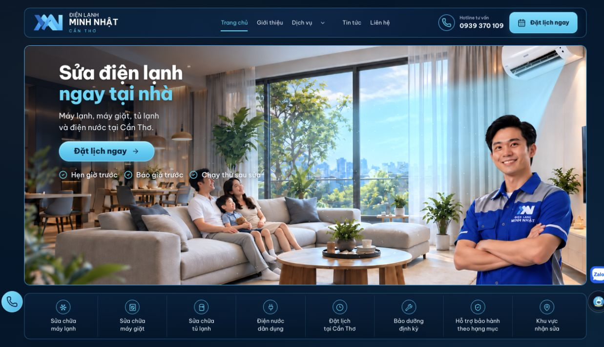
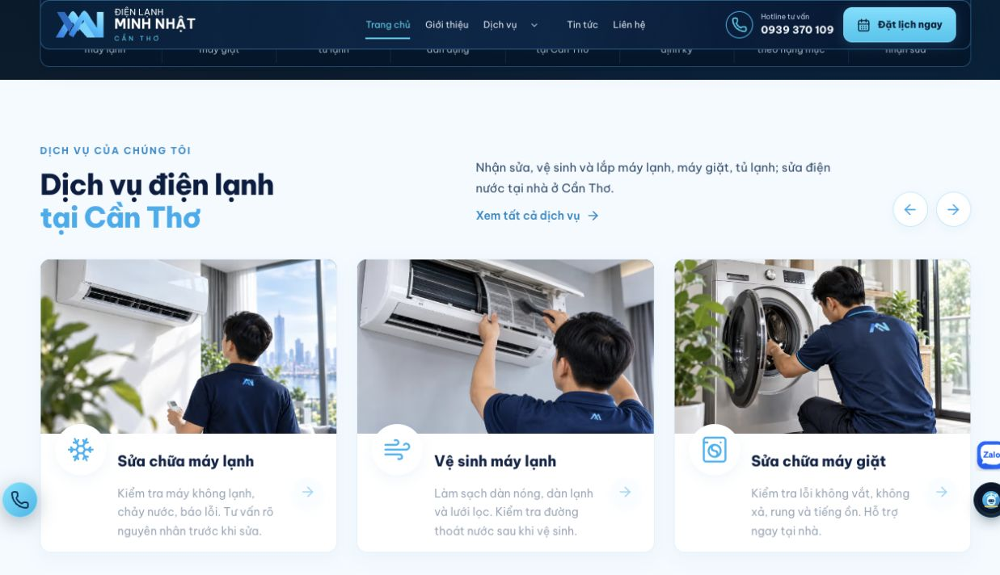
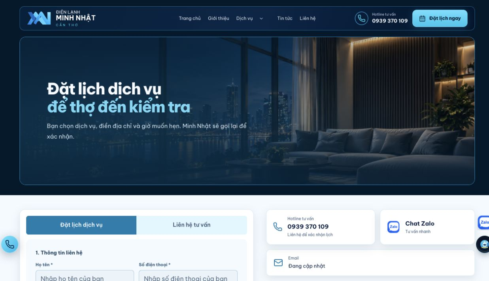
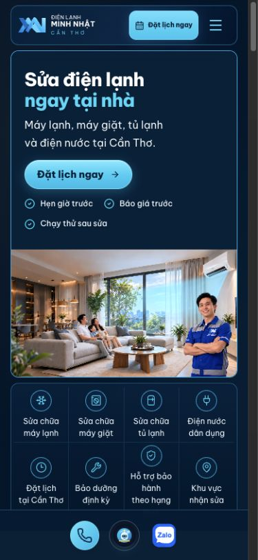
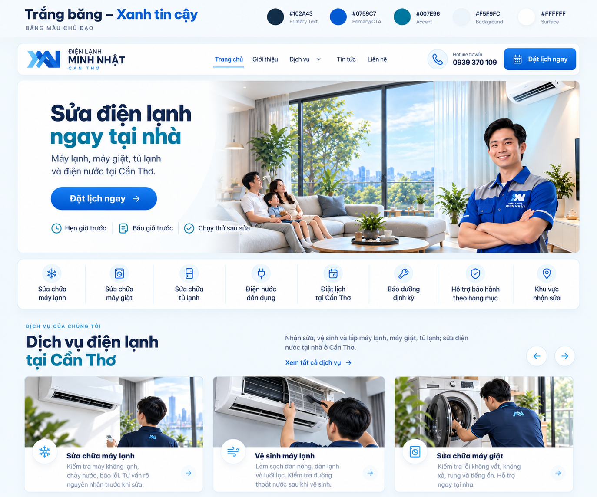
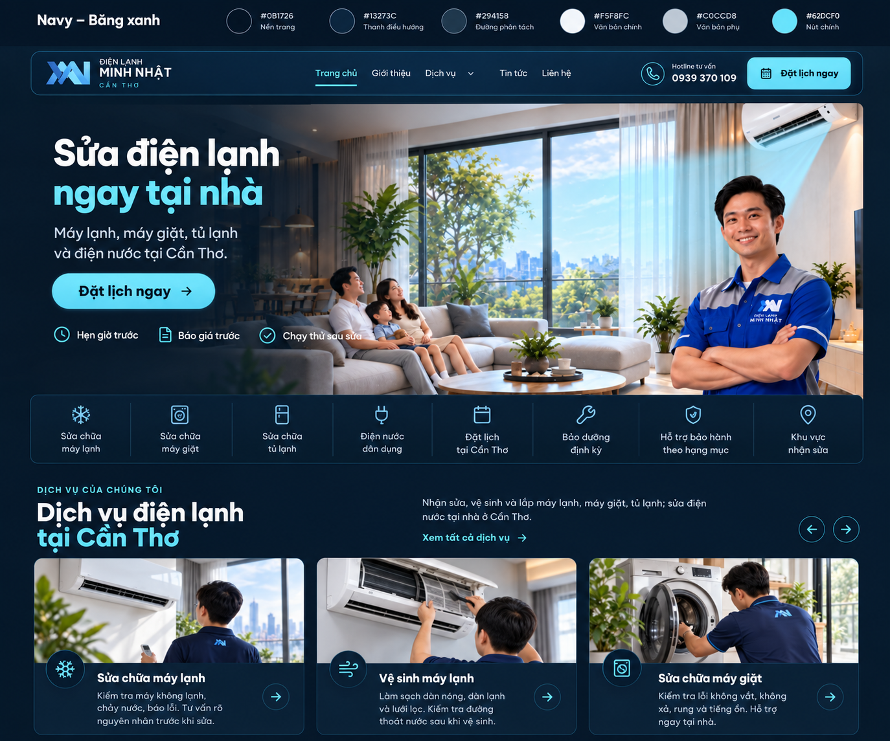
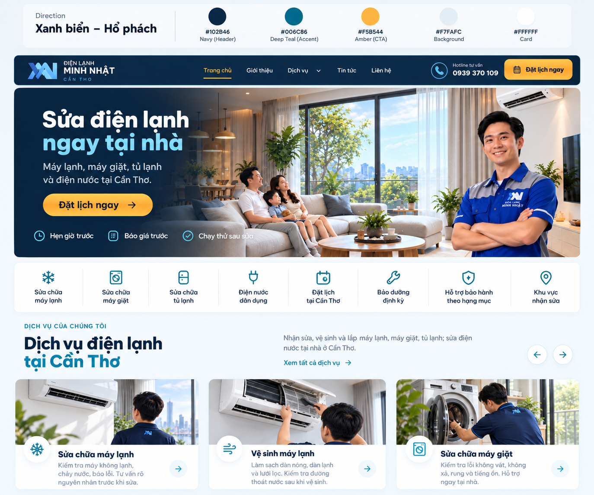

# Review bảng màu Điện Lạnh Minh Nhật

Ngày 26/10/2026. Review bản đang có trong workspace, chạy tại localhost:3000; chưa đối chiếu với bản triển khai ngoài Internet. Phạm vi: đầu trang chủ, thẻ dịch vụ, trang đặt lịch và đầu trang mobile. Mục tiêu: giúp khách đọc rõ dịch vụ và nhận ra hành động đặt lịch.

## Kết quả review

1. **Đầu trang chủ — nhận diện tốt, cần phân cấp màu rõ hơn.** Navy và cyan hợp cảm giác mát của ngành điện lạnh; màu xanh của logo và áo kỹ thuật viên đồng nhất. Tuy nhiên, tiêu đề nhấn, nút đặt lịch, icon và viền đều dùng sắc cyan khá nổi. Nên dùng một màu dành cho nút chính, giảm độ sáng và số lượng viền trang trí. Chữ trắng đặt trên ảnh cần vùng nền tối ổn định để giữ độ rõ khi hình thay đổi.

2. **Thẻ dịch vụ — tiêu đề dễ nhận biết, chữ phụ cần rõ hơn khi cuộn.** Nền trắng và xanh băng tạo khoảng nghỉ tốt. Trong trạng thái cuộn đã chụp, mô tả dịch vụ hiện nhạt; kiểm tra DOM tại thời điểm đó ghi nhận màu chữ rgb(56,87,118) nhưng opacity khoảng 0,52. Vì vậy cần xem cả màu lẫn hiệu ứng xuất hiện, không chỉ thay mã màu. Giữ nội dung ở độ rõ ổn định và dùng teal đậm cho liên kết trên nền sáng; hạn chế cyan sáng ở chữ nhỏ.

3. **Trang đặt lịch — cấu trúc nhận biết được, màu hành động chưa đồng nhất.** Header dùng nút cyan, trong khi tab đang chọn ở phần form dùng xanh trung bình. Nên thống nhất vai trò: màu nút chính cho gửi yêu cầu/đặt lịch; màu nền nhẹ cho trạng thái tab; màu chữ phụ đủ đậm để đọc. Giữ thanh điều hướng và phần nội dung cùng một hệ màu.

4. **Mobile — thông điệp rõ, nhiều chi tiết cùng tranh sự chú ý.** Tiêu đề và nút đặt lịch đọc được trên nền navy. Nút cyan ở header, CTA trong hero, icon và các nút liên hệ cố định đều khá nổi trong một màn hình nhỏ. Giảm sáng ở viền/icon phụ, giữ độ nổi cao nhất cho CTA; vẫn giữ màu nhận diện của Zalo.

## Ba mockup

Thứ tự dưới đây khớp thứ tự ba ảnh được hiển thị trong chat. Mockup tạo bằng công cụ Image Gen tích hợp, dùng ảnh chụp hiện tại làm tham chiếu. Đây là hình định hướng; ảnh, chữ và logo có thể có sai khác nhỏ do quá trình tạo hình. Mã màu trong bảng là thông số đề xuất khi triển khai, không phải cam kết mọi pixel trong ảnh đều khớp mã.

| Vai trò | 1 — Trắng băng / Xanh tin cậy | 2 — Navy / Băng xanh | 3 — Xanh biển / Hổ phách |
|---|---|---|---|
| Nền trang | #F5F9FC | #0B1726 | #F7FAFC |
| Bề mặt | #FFFFFF | #13273C | #FFFFFF |
| Chữ chính | #102A43 | #F5F8FC | #132B42 |
| Chữ phụ | #42556B | #C0CCD8 | #476176 |
| Nút chính | #0759C7 | #62DCF0 | #F5B544 |
| Chữ trên nút | #FFFFFF | #071B2D | #132B42 |
| Màu nhấn phụ | #007E96 | #9EBACB | #006C86 |
| Viền | #D9E4EC | #294158 | #DCE5EC |

### 1 — Trắng băng / Xanh tin cậy

Ưu tiên cảm giác sạch, dễ tiếp cận; nền sáng làm ảnh tự nhiên hơn. Cobalt cho CTA, teal cho chữ nhấn. Đây là hướng đề xuất nếu muốn giao diện sáng và dễ đọc cho khách gia đình.

### 2 — Navy / Băng xanh

Giữ hướng tối gần nhận diện hiện tại, làm liền mạch phần dịch vụ và nâng độ sáng chữ phụ. Giảm glow, dùng màu sáng tập trung vào CTA và các điểm nhấn cần thiết.

### 3 — Xanh biển / Hổ phách

Giữ navy và teal làm nhận diện, dành hổ phách cho đặt lịch. Sắc ấm giúp hành động chính phân biệt rõ hơn với liên kết và icon. Hổ phách nên chiếm dưới khoảng 5% diện tích giao diện để tránh cảm giác quá nhiều màu.

## Prompt set và giới hạn

Phương pháp: Image Gen tích hợp, ba lần tạo ảnh độc lập. Cả ba đều nhận hai ảnh tham chiếu 01-home-current.png và 02-home-services-current.png. Brief chung: mockup desktop 1440 × 1200, giữ nhận diện Minh Nhật, nội dung tiếng Việt, hotline, ảnh gia đình/kỹ thuật viên, header, hero, dãy dịch vụ và ba thẻ dịch vụ; ưu tiên thay bảng màu, không thêm tính năng hay lời quảng cáo. Dải tên và mã màu nằm ngoài giao diện website.

- Prompt hướng 1: nền trắng/xanh băng, chữ navy, CTA cobalt chữ trắng, teal đậm ở tiêu đề nhấn, ảnh tự nhiên, giảm glow và viền cyan.
- Prompt hướng 2: nền navy tối, bề mặt navy sáng hơn, chữ trắng ngà và xám sáng, CTA aqua chữ navy, phần dịch vụ tối đồng bộ, viền nhẹ.
- Prompt hướng 3: header/hero navy, phần dịch vụ trắng/xanh băng, teal đậm cho liên kết, CTA hổ phách chữ navy, dùng sắc ấm tiết chế.

Review dựa trên ảnh chụp trong phiên này và kiểm tra DOM chọn lọc. Chưa kiểm tra toàn bộ trang, trạng thái hover/focus/lỗi/thành công hoặc xác nhận mức tuân thủ accessibility. Chưa gửi form đặt lịch. Chưa thay mã nguồn giao diện. Khi triển khai phương án được chọn, cần kiểm tra tương phản trên CSS thực tế, cả trạng thái tương tác và mobile.
